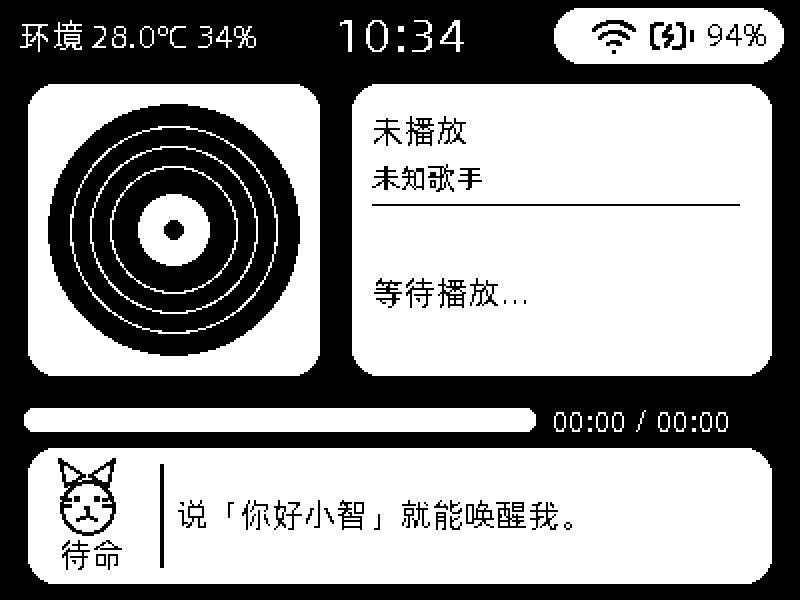

# xiaozhi-esp32-s3-rlcd-4.2

基于 [xiaozhi-esp32](https://github.com/78/xiaozhi-esp32) 的微雪 **ESP32-S3-RLCD-4.2** 定制固件。

4.2 英寸 400×300 单色 RLCD，集成翻页时钟、天气详情、今日待办、音乐播放、倒计时、语音对话与本地语音打断。

产品页面：[微雪 ESP32-S3-RLCD-4.2](https://www.waveshare.net/shop/ESP32-S3-RLCD-4.2.htm)

## 界面预览

以下均为设备 `GET /shot.bmp` 直出显存的 **400×300 原始画面（1:1，未放大）**：

| 天气主页 | 天气详情页 | 音乐页 | 倒计时页 |
| --- | --- | --- | --- |
|  |  |  |  |
| 翻页时钟、农历、环境温湿度、今日待办、AI 状态卡 | 大温度主视觉 + 体感/湿度/风 + AQI/能见度/气压 + 三日预报 + 日出日落/预警 | 唱片、歌名/歌手、三行歌词、进度条、AI 状态卡 | 纯黑底 + 居中 48px 白色剩余时间 |

## 功能特性

- **翻页时钟**：4 张 39×50 黑卡 + 1px 白中缝 + 两个 5×5 黑冒号，按分钟逐位更新；日期行显示「11月18日 星期三」。
- **农历 / 节气 / 节日**：顶栏显示农历日期，按「农历节日 > 公历节日 > 当日节气」优先级显示。
- **天气（和风主源 + 双免密钥兜底）**：和风 QWeather 取实时天气、体感、湿度、风、能见度、气压、AQI/PM2.5、三日预报、日出日落、灾害预警；失败自动回退中国天气网、Open-Meteo。
- **天气详情页**：独立整页分层展示全部天气维度，黑底白卡、图标化布局；实体按键 / 语音 / HTTP 三种进入方式。
- **今日待办（MCP 自取）**：设备作为 MCP 客户端保持长连接，每分钟调用 `list_todos`，只显示今天的事项，按时间升序、两行一条、超出高度自动裁剪。
- **音乐页**：唱片 + 歌名/歌手 + 三行歌词 + 进度条；歌名/歌手优先取飞牛 MCP `music_status`，歌词未随播放指令传入时自动从 LRCLIB 获取同步歌词。开始播放自动进入音乐页并保持停留，停止或播完自动回天气主页。
- **倒计时**：语音「倒计时 5 分钟」启动，支持暂停/继续/取消与多倒计时依次提醒；独立黑底白字倒计时页按秒刷新，到点弹窗响铃并自动回主页。
- **语音与音频**：离线唤醒词、设备端 AEC、本地 VAD 语音打断；开机默认静音，NVS 保留用户上次音量，调大音量自动解除静音。
- **AI 状态卡**：无 emoji 素材时使用内置矢量猫脸兜底，显示待命/聆听/说话等状态。
- **低功耗**：DVFS + Tickless + 自动 light sleep；电池电量按电压分段换算，充电状态按电压趋势推断。
- **在线调试**：HTTP 截图、页面切换、控件几何 dump、1-bit 二值化参数在线调节。
- **OTA**：支持服务器 OTA、DNS 兜底；默认横屏 400×300，切换一个宏即可使用竖屏 300×400。

## 硬件

| 项目 | 参数 |
| --- | --- |
| 主控 | ESP32-S3，16 MB Flash，8 MB PSRAM |
| 屏幕 | 4.2 英寸 RLCD，ST7305，原生 300×400，默认横屏 400×300 |
| 显示 SPI | DC 5 / CS 40 / SCK 11 / MOSI 12 / RST 41 / TE 6 |
| 音频 | ES8311 输出 + ES7210 输入，MCLK 16 / BCLK 9 / WS 45 / DIN 10 / DOUT 8，PA GPIO46 |
| 传感器 | SHTC3 温湿度（I2C 0x70）、PCF85063 RTC（I2C 0x51） |
| 电池检测 | ADC1_CH3 / GPIO4，200K/100K 分压，×3.0 |
| 按键 | BOOT GPIO0 / USER GPIO18 |

说明：PWR 开关机、CHG/WRN 指示灯由电源/充电芯片直接控制，SoC 无对应 GPIO；固件不读取 STAT 引脚，充电状态由电压趋势推断。

## 快速开始

### 1. 环境

- ESP-IDF **v6.0.1 或更高**（推荐 `release/v6.1`）
- Python 3、Git
- Windows / Linux / macOS 均可，Linux 编译更快

### 2. 编译

```bash
git clone https://github.com/78/xiaozhi-esp32.git
cd xiaozhi-esp32

idf.py set-target esp32s3
idf.py menuconfig
# Xiaozhi Assistant -> Board Type -> Waveshare ESP32-S3-RLCD-4.2

idf.py build
```

也可以使用项目脚本：

```bash
python scripts/build.py waveshare/esp32-s3-rlcd-4.2 --language zh-CN
```

### 3. 烧录与串口

```bash
# Linux
idf.py -p /dev/ttyACM0 flash monitor

# Windows
idf.py -p COM7 flash monitor
```

首次启动会自动进入配网；配网完成后设备连接后端并开始拉取天气与待办。

## 界面与操作

### 天气主页

- 顶栏：环境温度/湿度、农历、WiFi/电池胶囊。
- 时钟卡：日期、翻页时钟、当前城市 + 天气 + 温度。
- 待办卡：标题「待办」+ 完成/星标图标 + 今日事项列表，每项两行（时间 + 内容）。
- AI 卡：猫脸 + 情绪标签 + 当前状态文案。

### 天气详情页

按「主信息 → 次信息 → 指标 → 预报 → 底栏」分层：

1. **Hero**：大温度数字 + 城市 + 天气徽标 + 今日温差。
2. **次级信息**：体感、湿度、风向风级。
3. **指标条**：AQI/PM2.5、能见度、气压。
4. **三日预报**：今天/明天/后天，最高温 24px、最低温 14px。
5. **底栏**：日出日落 + 气象预警；有预警时黑底白字白框反色。

### 音乐页

- 左侧唱片，右侧歌名/歌手/三行歌词。
- 底部进度条与播放时间。
- 底部 AI 卡与天气页共用。
- 播放中显示实时歌词；空闲时显示飞牛 MCP 上次播放记录。

### 倒计时页

- 独立整页，纯黑底 + 居中 48px 白色 MM:SS，只显示倒计时剩余时间。
- 语音指令：`self.countdown.start`（秒数 1..86400）、`pause`（暂停闹钟）、`resume`（继续闹钟）、`cancel`（取消闹钟）、`status`。
- 最多同时 4 个倒计时，到点按启动顺序依次提醒；提醒期间显示「时间到！」并播放提示音，随后自动回天气主页。
- 倒计时进行中按键/MCP 切页会被保持在该页，避免误触离开。

### 页面切换

- 实体 USER 按键循环：天气 → 天气详情 → 音乐 → 天气。
- MCP：`self.disp.switch`，参数 `mode=weather|detail|music`。
- HTTP：`GET /page?p=weather|detail|music|toggle`。
- 自动切页优先级：倒计时 > 音乐播放 > 天气查询，进行中时手动切页会被忽略；结束后回到天气主页。
- 天气查询：`self.weather.query` 会把当日天气拼成播报文本、切到详情页，按文本长度估算播报时间后自动返回主页。

## 数据来源

### 天气

```
和风 QWeather（有 host + key）
  → 中国天气网 itboy（免密钥）
  → Open-Meteo（免密钥备用）
```

城市来源优先级：

```
NVS weather/city（手动 self.weather.set_city）
  > 后端 GET /xiaozhi/weather 下发
  > 上次后端城市缓存
  > config.h WEATHER_CITY
  > IP 定位（仅以上都为空时）
```

- 刷新：启动后 15 秒首次拉取，成功每 15 分钟刷新；失败按 60→120→240→300 秒退避。
- 和风凭证：控制台「项目管理」的 API Host + KEY，不要使用天气插件密钥。
- 和风 host 必须逐字符核对，错误 host 会表现为所有接口 403 且响应体为空。

### 待办

- 设备通过独立 WebSocket 连接外部 MCP 接入点。
- 握手一次后复用长连接，每分钟调用 `list_todos(view=today, limit=10)`。
- 断线自动重连；服务端 ping，客户端回 pong。
- 支持 `self.todo.set_url` 修改地址、`self.todo.sync` 手动覆盖列表。

### 音乐

- 歌名/歌手：飞牛 MCP `music_status` 返回「上一次播放：<歌名> - <歌手>（时间）」。
- 播放地址：飞牛 MCP `music_play` 返回直链，15 分钟有效，播放前现取。
- 歌词：`self.music.play_url` 未传 `lyric`/`lyric_url` 且歌名/歌手已知时，自动查询 LRCLIB；`syncedLyrics` 优先，无时间轴时用 `plainLyrics` 生成每 4 秒一行的伪 LRC，`duration` 作为总时长。

## 语音与音频

- **唤醒**：ESP-SR 离线唤醒词，默认「你好小智」。
- **AEC**：设备端 AEC 开启（`CONFIG_USE_DEVICE_AEC=y`、`AUDIO_INPUT_REFERENCE=true`），TTS 播放期间保持全双工监听。
- **本地 VAD 打断**：仅在 Speaking + Realtime 模式下生效；人声持续 300 ms 确认，TTS 起播后 800 ms 为热身期，避免自打断；确认后 abort 当前回答、清发送队列并回到监听。
- **开机静音**：`Application::Initialize()` 在音频启动后 `SetMute(true)`，硬件输出为 0；NVS 保存的用户音量不变。语音或 `self.audio_speaker.set_volume` 调大音量时自动解除，传 0 则重新静音。
- **状态栏静音图标**：按 `codec->muted() || output_volume() == 0` 判断。

## 1-bit 显示实现

### 二值化

- LVGL 使用 RGB565 全屏缓冲，`Lvgl_flush_cb` 先转 BT.601 亮度，再按阈值转 1-bit。
- 默认硬阈值 `dither_mode=0`、`threshold=112`；在线可调：`GET /dither?mode=0..4&thr=16..240`。
- Bayer4/Bayer8/带状抖动对本 UI 为负优化，默认关闭。

### 字库与图标

- 动态中文：`font_puhui_16_1_full`，16px / 1bpp / 6656 字形，缺字回退 `font_puhui_14_1`。
- 小字：`font_puhui_14_1`，14px / 1bpp 全字库。
- 静态短文案：`font_puhui_16_1`，16px / 1bpp / 447 字子集，体积最小。
- 图标：`font_material_symbols_16_1`，16px / 1bpp / 95 字形。
- 数字/时钟：`alibaba_puhui_16/24/48`、`alibaba_black_64`，均为 1bpp 点阵。
- 不再使用 4bpp 字体；所有文字和图标在 flush 前就是二值点阵，避免阈值在笔画边缘切出灰阶毛边。

### 竖屏

`config.h` 修改：

```c
#define RLCD_PORTRAIT 0   // 0 = 横屏 400x300（默认）  1 = 竖屏 300x400
```

竖屏不是旋转画面，而是重新排版：天气主页四张卡改为整宽单列堆叠；音乐页唱片缩小、信息卡加高；驱动按方向切换 LUT。

## HTTP 调试端点

设备联网后启动只读 HTTP 服务（端口 8080）：

| 端点 | 用途 |
| --- | --- |
| `GET /shot.bmp` | 400×300 单色 BMP，直读显存 |
| `GET /dbg` | 关键控件文本/位置/尺寸、dither 参数 |
| `GET /page?p=weather\|detail\|music\|toggle` | 远程切页 |
| `GET /dither?mode=0..4&thr=16..240` | 在线调整二值化参数 |
| `GET /countdown?action=start\|pause\|resume\|cancel\|status&sec=300` | 触发/查询倒计时（无语音环境调试） |
| `GET /weather_query?ms=15000` | 模拟天气查询，切详情页并在 ms 后自动返回 |
| `GET /music_play?url=...&title=...&artist=...` | 用指定直链模拟播放，验证自动切音乐页 |
| `GET /music_stop` / `GET /music_state` | 停止播放 / 查询播放状态与当前页 |

主机截图：

```bash
python shot_fetch.py 192.168.137.104 out.png
# 输出 400x300 原始尺寸 PNG，不做放大
```

## 目录结构

```text
main/boards/waveshare/esp32-s3-rlcd-4.2/
├── config.h                     # 板级引脚、分辨率、默认参数
├── config.json                  # 板型描述与 sdkconfig_append
├── waveshare-s3-rlcd-4.2.cc     # 板级初始化
├── rlcd_driver.{h,cc}           # ST7305 RLCD 驱动
├── custom_lcd_display.{h,cc}    # LVGL 显示、flush、页面切换
├── weather_ui.cc                # 天气主页
├── detail_ui.cc                 # 天气详情页
├── music_ui.cc                  # 音乐页
├── countdown_ui.cc              # 独立倒计时页
├── ui_widgets.{h,cc}            # 状态胶囊、AI 卡等复用控件
├── ui_assets.h                  # 字体/图片声明
├── managers/                    # 天气、待办 MCP、传感器、电源、农历等
├── assets/fonts/                # 1bpp 字体与图标
├── docs/screenshots/            # README 界面截图
└── README.md
```

## 已知限制

- RLCD 只有黑白两态，没有灰阶；界面不依赖颜色区分信息。
- 电池电量与充电状态为软件电压推算，不是库仑计，插拔瞬间可能误判。
- 音乐直链由飞牛 MCP 提供，有效期约 15 分钟；歌词走 LRCLIB，网关当前无歌词工具。
- 设备端 AEC 已开启，但实际回声消除效果需按房间/音量现场验证。
- 截图接口输出 400×300 1-bit BMP，不提供彩色或更高分辨率。

## 相关文档

- [微雪 ESP32-S3-RLCD-4.2 产品页](https://www.waveshare.net/shop/ESP32-S3-RLCD-4.2.htm)
- [微雪官方文档](https://docs.waveshare.net/ESP32-S3-RLCD-4.2/)
- [微雪官方示例](https://github.com/waveshareteam/ESP32-S3-RLCD-4.2)
- [xiaozhi-esp32 上游项目](https://github.com/78/xiaozhi-esp32)
- [自定义板卡指南](../../../../docs/custom-board_zh.md)
- [MCP 协议说明](../../../../docs/mcp-protocol_zh.md)
- [WebSocket 协议](../../../../docs/websocket_zh.md)

## 致谢

- [78/xiaozhi-esp32](https://github.com/78/xiaozhi-esp32)：小智 AI 对话终端固件
- [Waveshare](https://www.waveshare.net/)：ESP32-S3-RLCD-4.2 硬件与示例
- 飞牛音乐 MCP、LRCLIB、和风天气、中国天气网、Open-Meteo 等数据服务
