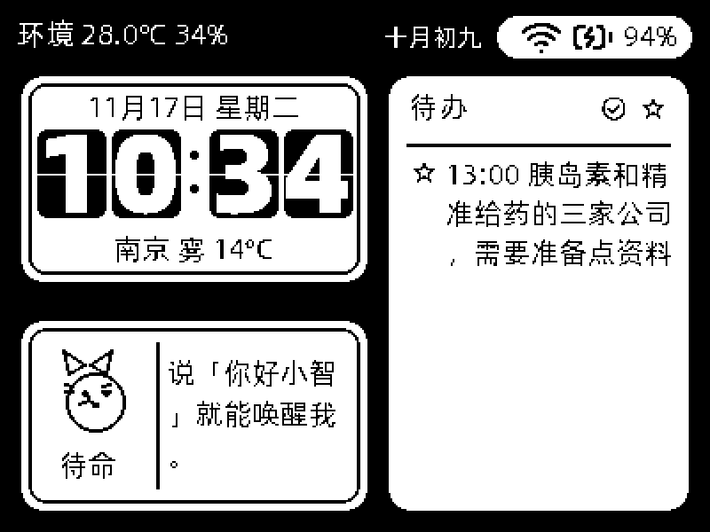
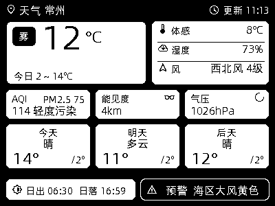

# 产品链接

[微雪电子 ESP32-S3-RLCD-4.2](https://www.waveshare.net/shop/ESP32-S3-RLCD-4.2.htm)

# 编译配置命令

**克隆工程**

```bash
git clone https://github.com/78/xiaozhi-esp32.git
```

**进入工程**

```bash
cd xiaozhi-esp32
```

**配置编译目标为 ESP32S3**

```bash
idf.py set-target esp32s3
```

**打开 menuconfig**

```bash
idf.py menuconfig
```

**选择板子**

```bash
Xiaozhi Assistant -> Board Type -> Waveshare ESP32-S3-RLCD-4.2
```

**编译**

```ba
idf.py build
```

**下载并打开串口终端**

```bash
idf.py build flash monitor
```

## 界面预览（实机截图）

400×300 1-bit 面板实机截图（`GET /shot.bmp` 直读显存，2× 放大）：

| 天气主页 | 天气详情页 | 音乐页 |
| --- | --- | --- |
|  |  |  |
| 翻页时钟 + 地址/天气 + 今日待办 + AI 卡 | 体感/湿度/风/能见度/气压/AQI/三日预报/日出日落/预警 | 唱片 + 歌名歌手歌词 + 进度条 + AI 卡 |

## 功能一览

- **翻页时钟**：4 张 39×50 黑卡 + 1px 白中缝 + 两个 5×5 黑冒号，每分钟按 `tm_hour/10`、`%10`、`tm_min/10`、`%10` 逐位翻牌；日期行「11月17日 星期二」。
- **农历 / 节气 / 节日**：顶栏显示农历（如「十月初九」），含节气与节日。
- **天气（双源 + 免密钥兜底）**：地址由后端 `/xiaozhi/weather` 下发（手动配置优先，IP 定位仅兜底）；和风 QWeather 主源取实时/体感/湿度/风向风级/能见度/气压/AQI/PM2.5/三日预报/日出日落/灾害预警；失败自动回退中国天气网、Open-Meteo。时钟卡第三行只显示「地址 天气 温度」。
- **天气详情页**：独立整页展示全部天气维度，实体键循环 / 语音 `self.disp.switch mode=detail` / HTTP `/page?p=detail` 三种进入方式。
- **待办（MCP 自取）**：设备作为 MCP 客户端与外部接入点保持长连接，每分钟调 `list_todos`；只显示**今天**的待办，行格式「20:00 标题」；也可用 `self.todo.sync` 手动下发。
- **音乐页**：唱片 + 歌名/歌手/三行歌词 + 进度条；顶栏左环境温湿度、中时钟、右 WiFi/电池胶囊。歌名/歌手优先取飞牛 MCP `music_status` 的上次播放记录，歌词未随播放指令传入时自动从 LRCLIB 拉取同步歌词。
- **开机静音**：启动后音频硬件音量为 0，NVS 里保存的用户音量不变；语音或 MCP 调大音量时自动解除静音。
- **AI 对话卡**：无 emoji 素材时用内置矢量猫脸兜底，显示状态文案与情绪。
- **屏幕截图与调试端点**：`GET /shot.bmp`（1-bit BMP）、`GET /dbg`（关键控件几何）、`GET /page?p=weather|detail|music|toggle`（远程切页）、`GET /dither?mode=&thr=`（二值化调参）。
- **1-bit 显示优化**：默认硬阈值 112（可调），可选 Bayer4/Bayer8/带状抖动；静态文案使用 16px 1bpp 点阵字库，动态中文用 4bpp 字库。
- **低功耗**：DVFS + Tickless + 自动 light sleep；充电状态按电压趋势推断。
- **OTA**：服务器配置 + DNS 兜底；支持横屏 400×300 / 竖屏 300×400 两种排版。

## 界面布局（复刻微雪成品界面）

尺寸来自对微雪成品实机照片的实测（把屏幕区域透视矫正到 400×300 后按像素量取），横屏采用「左栏时钟 + AI，右栏整高待办」的两栏布局：

~~~text
┌──────────────────────────────────────────────┐
│ 环境 32.1°C 39%      十月初八 ╭─WiFi─▭─99%─╮ │
│ ┌─────────────────┐ ┌─────────────┐          │
│ │ 10月2日 星期五   │ │ 待办    ☑ ★ │          │
│ │ ███ 17:18 ███    │ │ ─────────── │          │
│ │ 成都 晴间多云 23°C│ │ ★ 抢火车票  │          │
│ ├─────────────────┤ │ ★ 记得吃饭  │          │
│ │ [猫] 待命 │AI 待命│ │ ★ 联动方案  │          │
│ └─────────────────┘ └─────────────┘          │
└──────────────────────────────────────────────┘
~~~

- 卡片尺寸：时钟卡 199×120 @(10,41)、待办卡 173×249 @(217,41)、AI 卡 199×111 @(10,179)；`pad=10`、`gap=8`。AI 卡高度取 `UI_SCR_H - ai_y - 10`，使其底边与待办卡底边同在 y=290。
- 顶栏（黑底白字）：左侧 `sensor_label_` 显示「环境 温度 湿度」，右侧 `lunar_label_` 显示农历/节气/节日（14px），最右是 WiFi + 电池胶囊（110×24）。
- 时钟卡内三行：日期行（`day_label_`，16px，居中）→ **翻页时钟**（4 张 39×50 黑底圆角卡片，每张一位数字，`alibaba_black_64` 白字，卡片中央叠 1px 白色中缝；两位之间是两个 5×5 黑色圆角冒号方块；数字由 `time_digit_label_[4]` 分别写入时十/时个/分十/分个）→ 天气行（`weather_label_`，16px，居中，「城市 天气 温度°C」）。外框 2px + 内框 2px 双层圆角描边。
- 待办卡：标题「待办」+ 右上 ☑ ★ 两个 material symbols 图标 + 分隔线 + 列表容器 `memo_rows_`（`LV_FLEX_FLOW_COLUMN`，位置 `(12,44)`、尺寸 `memo_rows_w_ × (todo_h-50)`，`pad_row=3`）。**每项占两行**：第一行「★ + 时间」（时间用 16px 1bpp 字库，纯 ASCII；全天待办显示「全天」，无时间显示 `--:--`），第二行「事项」文本（`font_puhui_16_1_full`，`text_line_space=1`，占满整行宽自动换行，**`max_height=42` + `LV_LABEL_LONG_DOT` 最多两行、超出显示省略号**）。**项与项之间画一条虚线**（`lv_line` + `line_width=2` + `line_dash_width=5` / `line_dash_gap=4`，点数组存 `memo_dash_pts_[6][2]` 成员，因为 `lv_line` 不拷贝点数组；最后一项之后不画）。最多建 6 项，建完 `lv_obj_update_layout` 量出实际高度后裁剪，放不下的折成「…还有N条」（实测可用高度 199px，单行项 45px、两行项 66px，通常可放 3 项）。
- 待办数据来自 NVS `memo/items`（JSON 数组，字段 `t`=时间行如 `13:00`／`全天`，`c`=事项内容），由 MCP 工具 `self.memo.add / list / done / clear` 增删，或由 `self.todo.sync` 整批覆盖；`RefreshMemoDisplayInternal()` 每次清空容器重建行。
- AI 卡：左侧 56px 表情区（48px 表情图 + 情绪标签），竖线分隔（距左边 70px），右侧状态文字左对齐垂直居中；卡片高度 < 90px 时自动切紧凑模式（表情 30px、14px 字体）。
- 字体：中文文案统一用 `font_puhui_16_1_full`（16px/1bpp，6656 字形，缺字回退 `font_puhui_14_1`）和 `font_puhui_14_1`；图标用 `font_material_symbols_16_1`（16px/1bpp 点阵，`material_symbols.h` 的 `MATERIAL_SYMBOLS_STAR` / `MATERIAL_SYMBOLS_CHECK_CIRCLE`）；大字时间用 `alibaba_black_64`。**注意**：`alibaba_puhui_16` 字符集不含「环境」，顶栏必须用 `font_puhui_16_1_full`，否则整词不显示。
- 竖屏 300×400 为整宽纵向堆叠：时钟卡 280×140 → 待办卡 280×138 → AI 卡 280×55。

**微调位置**（都在 `weather_ui.cc` 的卡片几何块）：改 `clock_h` / `todo_h` / `ai_h` 可调整三张卡比例；`day_label_` / 翻页时钟 / `weather_label_` 的 `lv_obj_align` / `flip_y` 控制卡内三行位置；翻页卡片尺寸是 `flip_card_w`(39) / `flip_card_h`(50) / `flip_gap`(3) / `colon_w`(10)；`lunar_label_` 的 `-128` 是胶囊左侧的让位量；待办行间距是 `memo_rows_` 的 `lv_obj_set_style_pad_row`。

## 音乐页布局（沉浸式播放器）

~~~text
┌──────────────────────────────────────────────┐
│ 环境 26.4°C 36%     09:17  ╭─WiFi─▭─94%─╮   │
│ ┌────────────┐ ┌──────────────────────┐      │
│ │  ◉ 唱片     │ │ 未播放                │      │
│ │ (150×150)  │ │ 未知歌手              │      │
│ │            │ │ ──────────────────── │      │
│ │            │ │ 等待播放...           │      │
│ └────────────┘ └──────────────────────┘      │
│ ▬▬▬▬▬▬▬▬▬▬▬▬▬▬▬▬▬▬▬▬   00:00 / 00:00      │
│ ┌──────────────────────────────────────┐     │
│ │ [猫] 待命 │ 说「你好小智」就能唤醒我 │     │
│ └──────────────────────────────────────┘     │
└──────────────────────────────────────────────┘
~~~

- 顶栏一行三块（黑底白字）：左 `music_sensor_label_`「环境 温度 湿度」（16px 1bpp 点阵，`TOP_LEFT(10,9)`）、中 `music_time_label_` 时钟（`alibaba_puhui_24`，`TOP_MID(0,6)` **水平居中**）、右 WiFi+电池胶囊（115×28 @`TOP_RIGHT(-8,4)`）。三者宽度由 `SetupMusicUI` 末尾的 `ESP_LOGI` 打印（需先 `lv_obj_update_layout()` 否则读出来是 0）。
- 内容区从 `content_y = 40` 开始：左唱片卡 150×150 @(12,40)（黑色圆盘 130、三层白色纹路 104/84/64、白心 40 + 黑色小孔 10），右侧信息卡 226×150（歌名 16px、歌手 14px、分隔线、三行歌词 prev/current/next）。
- 进度条：白轨 + 黑指示器 + 2px 内 padding 形成白边，`bar_w = 400-24-120 = 256`，右侧 `music_progress_label_` 显示 `00:00 / 00:00`。
- 底部 AI 卡 376×72 @(12,222)：40px 猫脸 + 「待命」+ 竖分隔线 + 状态文字，与天气页 AI 卡同一套（`CreateCatFace()` 定义在 `weather_ui.cc`、声明在 `ui_cat_face.h`，两页共用）。
- **1-bit 坑**：`LV_OPA_20/40` 的低不透明度在 1-bit 屏上会被阈值直接吃掉（40% 白亮度 102 < 阈值 112 → 变黑），唱片纹路和分隔线必须用 `LV_OPA_COVER` 才看得见。
- 字体：静态文案用 16px 1bpp 点阵（`font_puhui_16_1`），歌名/歌手/歌词/状态文字等动态中文用 `font_puhui_16_1_full`。

### 音乐数据来源（飞牛 MCP + LRCLIB 歌词）

- **歌名/歌手**：待办 MCP 客户端 `TodoMcpClient` 在每轮 `list_todos` 之后追加一次 `music_status` 调用，解析 `上一次播放：<歌名> - <歌手>（时间）`。仅当当前在音乐页且没有本地播放时，`data_update_task.cc` 才把结果写进 `music_title_label_` / `music_artist_label_`；播放中由播放任务接管，避免覆盖实时信息。切到音乐页会 `RequestRefresh()` 立即拉一次。
- **播放**：语音或 `self.music.play_url` 传 `url/title/artist` 即进入音乐页播放；直链由飞牛 MCP 的 `music_play` 给出（15 分钟有效，播放前现取）。
- **歌词**：`self.music.play_url` 未传 `lyric`/`lyric_url` 且歌名、歌手已知时，`Application::PlayMusicFromUrl()` 自动拼 LRCLIB 查询 URL（`https://lrclib.net/api/get?artist_name=…&track_name=…`）。`MusicPlaybackTask` 解析 `syncedLyrics`；没有时间轴时用 `plainLyrics` 按每 4 秒一行生成伪 LRC；`duration` 用作进度条总时长。
- 飞牛网关当前没有歌词工具（`music_play` 只返回歌名/歌手/直链），因此歌词走 LRCLIB 兜底；后续网关补 `music_lyrics` 后可改为优先网关。

### 开机静音

- `Application::Initialize()` 在 `audio_service_.Start()` 之后调用 `codec->SetMute(true)`，硬件输出音量置 0；NVS 里的 `audio/output_volume` 保留用户上次音量，不会被写成 0。
- 解除静音：语音调大音量或 `self.audio_speaker.set_volume` 传 `volume>0` 时自动 `SetMute(false)` 并恢复原音量；传 0 则重新静音。
- `AudioCodec::SetOutputVolume()` 统一走 `ApplyOutputVolume(muted_ ? 0 : output_volume_)`；`BoxAudioCodec::EnableOutput(true)` 重新打开输出时也走该函数，不会绕过静音。状态栏静音图标按 `codec->muted() || output_volume()==0` 判断。

### 语音打断（设备端本地 VAD）

- 设备端 AEC 开启（`CONFIG_USE_DEVICE_AEC=y`、`AUDIO_INPUT_REFERENCE=true`）时，TTS 播放期间音频处理链路仍保持全双工监听。
- `Application` 监听 VAD 回调：仅在 `kDeviceStateSpeaking` + `kListeningModeRealtime` 下生效；人声需持续 300ms 才确认打断，TTS 起播后 800ms 为热身期，避免起播杂音或残余回声造成自打断。
- 确认后执行 `AbortSpeaking(kAbortReasonNone)` → 清空发送队列 → `SetListeningMode(GetDefaultListeningMode())`；服务端收到 abort 立即回 `{"type":"tts","state":"stop"}`。
- 常量在 `main/application.cc` 匿名命名空间：`kLocalVadBargeInHoldUs`、`kLocalVadBargeInWarmupUs`。非 AEC 模式仍走唤醒词/按键打断。

## 天气数据源（和风天气优先，免密钥兜底）

`WeatherManager::update()` 是一条三级链路，任何一级成功就返回：

```
和风 QWeather（有 host+key 时）→ 中国天气网 itboy（免密钥）→ Open-Meteo（免密钥备用）
```

### 和风天气（主源）

凭证优先级（后者被前者覆盖）：`config.h` 的 `QWEATHER_HOST` / `QWEATHER_KEY`（默认空）→ 编译期 `managers/weather_qweather_secret.h`（**已 gitignore，不入库**）→ NVS `weather/api_host` + `weather/api_key`（运行时配置，host 与 key 都非空才生效）。

> **必须用控制台「项目管理」里的 API Host 和 KEY**，不能用「天气插件密钥」——插件密钥直连所有接口都是 HTTP 403 空响应体。
> **host 必须逐字符核对**：真实踩坑是 `pa3qqqhxe.re.qweatherapi.com` 少写了一个 `a`，表现为**所有接口 403 且响应体为空**（连不带 key 都 403）；正确 host 是 `pa3qqqahxe.re.qweatherapi.com`。

一次更新依次请求 4 个接口（host 前缀 `https://<api_host>`，key 走 `?key=` 或 `X-QW-Api-Key` 头均可）：

| 接口 | 用途 | 响应大小 |
| --- | --- | --- |
| `/v7/weather/now?location=<LocationID>&lang=zh` | 温度/天气现象/体感/湿度/风向风级/能见度/气压 | ~450 B |
| `/v7/air/now?location=<LocationID>` | AQI / 类别（优/良/…）/ PM2.5 | ~1.7 KB |
| `/v7/weather/3d?location=<LocationID>&lang=zh` | 未来 3 天（含日出日落，取第 1 天） | ~1.7 KB |
| `/v7/warning/now?location=<LocationID>&lang=zh` | 灾害预警（`warning[0].typeName` + `severityColor`，无预警为空数组） | ~250 B |

### 城市从哪来（后端下发优先，手动配置最高，IP 定位兜底）

城市来源优先级（高 → 低）：

```
NVS weather/city（手动配置 self.weather.set_city）
  > 后端 GET /xiaozhi/weather（config.yaml 的 device_location）
  > 上次后端地址缓存（NVS weather/backend_city）
  > config.h WEATHER_CITY（默认「常州」）
  > IP 定位（ip-api → ipapi.co → ipinfo.io，仅 WEATHER_CITY 为空时）
```

**为什么之前不准**：IP 定位只能定位到**运营商出口 IP** 所在城市（NAT/CGNAT 会把一片区域的用户汇聚到同一出口，常见偏差到省会或邻近地市，城市级精度经验值约 55–80%）。设备在常州、出口 IP 被判到南京就是这种情况。现在默认**由后端告诉设备实际所在地**：后端 `GET /xiaozhi/weather` 用和风 `geo/v2/city/lookup` 归一化城市，返回 `city` / `adm` / `location_id`；设备拿到 LocationID 后直接查天气，不再自己猜。

- 后端下发：`LocateFromBackend()` 请求 `WEATHER_BACKEND_GEO_URL`（默认 `https://xiaozhiweb.hqgg.top:59826/xiaozhi/weather`），解析 `data.city` / `data.adm` / `data.location_id`，写入 `loc_id_` 并缓存 NVS `weather/backend_city` / `backend_adm` / `backend_loc_id`；成功日志 `后端天气地址: 江苏省 常州 (101191101)`。后端位置在 `xiaozhi-server/config.yaml` 的 `plugins.get_weather.device_location` 配置（本仓库示例填「常州」），改完需重启后端。部署时 nginx 需加**精确匹配** `location = /xiaozhi/weather { proxy_pass http://127.0.0.1:8003/xiaozhi/weather; }`（精确匹配优先于 `/xiaozhi/` 前缀），否则 59826 上的 `/xiaozhi/` 会被 manager-api 的鉴权兜底拦成 `401 Unauthorized`；设备拿不到 `code:0` 时会回退 NVS 后端缓存或 `config.h` 城市，不阻塞天气。
- 手动配置：MCP 工具 `self.weather.set_city`（`city` 必填、`province` 可选，用于重名城市消歧），置 `manual_city_ = true` 并持久化 NVS `weather/city`、`weather/adm`，同时清空缓存的 LocationID；`self.weather.get_city` 可查当前城市 / 来源 / LocationID 做诊断。手动配置优先级高于后端。
- IP 定位（仅后端不可用、无后端缓存且 `WEATHER_CITY` 为空时）：`LocateByIp()` 依次试 `WEATHER_IP_GEO_URL`（`http://ip-api.com/json/?lang=zh-CN&fields=status,country,regionName,city,lat,lon`，纯 HTTP 免密钥）→ `WEATHER_IP_GEO_URL_ALT1`（`https://ipapi.co/json/`）→ `WEATHER_IP_GEO_URL_ALT2`（`https://ipinfo.io/json`），各 8 s 超时，全失败退回 NVS 缓存城市；成功写回 NVS `weather/ip_city` / `ip_region` / `ip_coord` 作为“上次定位缓存”。
- LocationID 解析顺序：缓存 `weather/loc_id` → 有经纬度先按 `lon,lat` 反查（比城市名更准）→ 城市名（`province` 为中文时附 `&adm=` 消歧）→ 城市名单独 → 兜底 `WEATHER_CITY_CODE`；解析结果优先取 `adm2` 作显示名并去掉结尾「市」，`adm1` 记入上级，避免显示成区县名。
- 全部失败时退回后端缓存 → `config.h` 的 `WEATHER_CITY`（默认常州），**不阻塞**天气更新；只有 `WEATHER_CITY` 为空才退回上次 IP 定位缓存。
- 日志：`天气配置: 城市=…(来源=手动配置/后端缓存/上次定位缓存/IP 定位/默认)` / `后端天气地址: 江苏省 常州 (101191101)` / `IP 定位成功: 江苏 南京 (32.0607, 118.7630)` / `和风 geo 定位成功: 南京 (101190101, 上级=江苏省)`。

参考项目（GitHub 同类天气时钟的位置处理，均以手动/配置城市为主、IP 仅作首次默认，并取 city + region 双字段消歧）：
- [xinnan-tech/xiaozhi-esp32-server](https://github.com/xinnan-tech/xiaozhi-esp32-server) — `plugins_func/functions/get_weather.py`：先 `geo/v2/city/lookup` 拿 LocationID，失败直接回「暂时查不到 X 的天气」（我们借此发现后端天气也受错误 host 影响）。
- [leezicai/DuDuClock](https://github.com/leezicai/DuDuClock) — 城市写死在配置里，配网页改城市。
- [timschneeb/esp32-weather-clock-cube](https://github.com/timschneeb/esp32-weather-clock-cube) — 首次用 IP 服务定位、之后可手动覆盖。
- [nicholaswilde/cyd-weather-station](https://github.com/nicholaswilde/cyd-weather-station) — 城市/经纬度与 API key 一起存 NVS。
- [Kerrbty/ESP32C3Clock](https://github.com/Kerrbty/ESP32C3Clock)、[JHershey69/OpenWeatherOneCall](https://github.com/JHershey69/OpenWeatherOneCall) — 经纬度直传，避免城市名重名。

### 免密钥兜底（和风不可用时）

1. 中国天气网 `http://t.weather.itboy.net/api/weather/city/<城市代码>`（纯 HTTP）：`data.wendu`、`data.forecast[0].type`、`cityInfo.city`（去结尾「市」），并补齐 `data.shidu` 湿度、`today.aqi` / `data.quality` / `data.pm25`、`today.fx` / `today.fl` 风力、`today.sunrise` / `today.sunset`、`forecast[0..2]` 三日预报。
2. Open-Meteo `https://api.open-meteo.com/v1/forecast?...&current=temperature_2m,weather_code`，WMO 代码转中文。

兜底用的 `WEATHER_CITY_CODE` / `WEATHER_LAT` / `WEATHER_LON` / `WEATHER_CITY` 都在 `config.h`。

### 刷新策略

板级独立任务 `weather_fetch`（栈 8192）负责，HTTP 全程不持 LVGL 锁：启动后延迟 15 s 首次拉取，**成功每 15 分钟**（和风实时 10 分钟一更新、空气 1 小时一更新），**失败按 60→120→240→300 s 退避**，成功后清零。日志关键字：`天气更新成功(和风)` / `和风天气更新失败，回退免密钥数据源` / `天气更新成功(中国天气网)` / `天气配置: 城市=… 和风=已配置`。

### 屏幕呈现

时钟卡第三行只保留**一行**「地址 + 当前天气」：

```
南京 雾 14°C
```

（宽度锁 `clock_w - 20` + `LV_LABEL_LONG_CLIP` 防溢出；原来的预警/AQI/风力/日出日落/明日预报轮播已删除，这些维度全部搬到**天气详情页**，见下节。）

`WeatherData` 结构体（`managers/weather_manager.h`）承载全部字段 + `WeatherDaily daily[3]`，UI 层只读 `getLatestData()`，换源不改 UI。

## 天气详情页（完整维度）

独立页面 `detail_page_`（`detail_ui.cc`），横竖屏共用同一套结构，按「主信息 → 次信息 → 指标 → 预报 → 底栏」分层。**黑色底、白色圆角卡片、黑色文字**，与天气主页保持一致：

```
┌──────────────────────────────────────────────┐
│ ◉ 天气 常州                        🕘 更新 09:53│
│ ┌────────────────────┐ ┌───────────────────┐ │
│ │ [雾] 11 °C         │ │ 🌡 体感       7°C │ │
│ │ 今日 2~14°C        │ │ ☁ 湿度       78% │ │
│ │                    │ │ ➤ 风     西风 4级 │ │
│ └────────────────────┘ └───────────────────┘ │
│ ┌──────────┐ ┌──────────┐ ┌──────────┐       │
│ │AQI    PM2.5 64│ │能见度 👓 │ │气压   ◔  │       │
│ │104 轻度污染│ │5km       │ │1026hPa   │       │
│ └──────────┘ └──────────┘ └──────────┘       │
│ ┌──────────┐ ┌──────────┐ ┌──────────┐       │
│ │   今天   │ │   明天   │ │   后天   │       │
│ │    晴    │ │   多云   │ │    晴    │       │
│ │ 14° /2°  │ │ 11° /2°  │ │ 12° /2°  │       │
│ └──────────┘ └──────────┘ └──────────┘       │
│ ┌──────────────────┐ ┌──────────────────────┐ │
│ │☀ 日出 06:30 日落16:59│ │ ⚠ 预警 海区大风黄色 │ │
│ └──────────────────┘ └──────────────────────┘ │
└──────────────────────────────────────────────┘
```

- 几何：页边距 8、间距 6；标题行 y=6 h=18；Hero y=30，左卡宽 206（竖屏 160）/高 94（竖屏 112），右侧为体感/湿度/风三行并带 1px 分隔线；指标条 y=130 h=44；三日预报 y=180 h=66；底栏 `y=屏高-8-32` h=32（横屏日出卡宽 190，预警卡占剩余宽度；竖屏日出/预警各占整行）。竖屏把 `屏高-固定高度` 均摊到 4 个间距。
- 主次：Hero 用 `alibaba_puhui_48` 大温度数字 + 独立 `°C` 单位（`alibaba_puhui_24`，与数字间隔 6px、与天气徽标间隔 10px）+ 黑底白字天气徽标 + 今日温差；体感/湿度/风为 16px 次级信息；AQI/能见度/气压 44px 指标条；预报最高温 24px、最低温 14px；预警非空时黑底白字白框反色。
- 图标：`font_material_symbols_16_1`（16px/1bpp 点阵，`material_symbols.h`）。标题 `LOCATION_ON`/`SCHEDULE`；Hero 依次 `DEVICE_THERMOSTAT`/`CLOUD_DOWNLOAD`/`NAVIGATION`；指标 `FAVORITE`/`EYEGLASSES`/`PROGRESS_ACTIVITY`（AQI 卡右上角已有 PM2.5 数值，标题缩为「AQI」且不放图标，避免与 PM2.5 重叠）；日出 `BRIGHTNESS_6`；预警 `WARNING`。
- 字体：`alibaba_puhui_24/48` 是 1bpp 但字符集只覆盖常用天气字与数字，仅用于纯温度数字；动态中文（天气现象、城市、预警、能见度单位外的说明）统一用全字符集 `font_puhui_16_1_full`（16px/1bpp，6656 字形）或 `font_puhui_14_1`（14px/1bpp）；静态短文案可用 `font_puhui_16_1`。`font_puhui_16_1` 仅 447 字，缺「海/风/黄」等，**不能用于预警等动态中文**。竖屏 3 位数温度自动降为 24px 防裁切。
- 进入方式：**实体按键循环** 天气 → 天气详情 → 音乐 → 天气（`CycleDisplayMode()`）；MCP 工具 `self.disp.switch` 参数 `mode=detail`；调试端点 `GET /page?p=detail`。
- 刷新：`RefreshWeatherDetail()` 由 `data_update_task` 在详情页激活时调用，内部用整串数据做变更检测，没变就不碰控件（1-bit 屏重绘很贵）。
- 降级：任一字段缺失显示 `--`；三日预报不足 3 天时缺的格子显示 `今天/明天/后天 + --`；无预警显示「暂无气象预警」；预警颜色 `Blue/Yellow/Orange/Red/White/Black` 在 `weather_manager.cc` 里映射成 蓝色/黄色/橙色/红色/白色/黑色。

## 待办（MCP 接入点，设备自取）

设备本身就是 MCP 客户端：板级任务 `todo_mcp`（栈 8192）用独立 websocket 连外部 MCP 接入点，
按标准 JSON-RPC 握手后调用 `list_todos`（`view=today`, `limit=10`），把每条待办格式化成**两行**：第一行 `★ 20:00`（`t` 字段，全天为「全天」），第二行事项标题（`c` 字段）；**只保留今天**（`IsToday()` 拿 `due_text` 的日期和本地 `localtime_r` 的年月日比较，没有日期的视为今天），写入 NVS `memo/items` 并重绘右侧待办卡。

- **长连接**：握手（initialize）只做一次，之后在**同一条 websocket 上**每分钟发一次 `tools/call`。
  早期版本是每次拉取都新建连接（每次都要重做 TLS 握手），实测跑满 5 分钟后第二次握手会被对端
  在握手阶段关闭 TCP（`mbedtls_ssl_handshake returned -0x7280` = `MBEDTLS_ERR_SSL_CONN_EOF`），
  所以改成常驻会话 + 断线重连。
- 断线处理：建连最多重试 3 次（间隔 3 s）；连续 2 次拉取失败或 websocket 报错则关闭会话，
  等 20 s（或网络恢复事件）后重连。服务端每 20 s 发 ping，客户端自动回 pong 保活。
- 地址存 NVS `todo/mcp_url`；可用 MCP 工具 `self.todo.set_url`（参数 `url`，必须以 `ws://` 或 `wss://` 开头）修改，改完立即拉一次。
- 构建期默认值：`config.h` 的 `MCP_TODO_URL`（提交版为空）。本机可把真实地址放进
  `managers/todo_mcp_secret.h`（已在 `.gitignore`，避免 token 入库），首次启动会把编译期地址落到 NVS，
  之后一律以 NVS 为准。
- 时序：上电延迟 20 s 首次拉取；之后每 60 s 一次；网络刚连上会立刻补一次。
- 日志关键字：`连接待办 MCP 接入点(1/3)` / `MCP 会话已建立` / `已拉取当日待办 N 条` /
  `等待 list_todos 响应超时` / `连接已断开` / `空闲内存 ... 最大连续块 ...`。
- 协议要点：JSON-RPC 的真实路径是 `/mcp_endpoint/call/`（`/mcp/` 是注册侧，握手不回包）；
  握手 `id=1` initialize、`id=2` tools/call，结果在 `result.content[0].text`（一个 JSON 字符串：
  `{"ok":true,"count":N,"items":[{"title","due_text","all_day",...}]}`）。

- **排序与溢出**：设备侧按时间线升序显示（`std::stable_sort`：全天项最前 → 有具体时间的按 HH:MM → 无时间的排最后；同一时间保持服务端原始顺序）。屏幕**不再显示「…还有 N 条」**：渲染时按容器高度裁剪，能放几项放几项，勾掉/完成一项后下一项依次顶上。

手动兜底：后端 AI 也可调用设备工具 `self.todo.sync`（`items` 为 JSON 字符串数组，最多 10 行，`[]` 清空）直接覆盖列表。

## 硬件核对（对照微雪官方文档与官方示例）

数据来源：

- 文档：https://docs.waveshare.net/ESP32-S3-RLCD-4.2/
- 官方示例仓库：https://github.com/waveshareteam/ESP32-S3-RLCD-4.2 （gitee 镜像 https://gitee.com/waveshare/ESP32-S3-RLCD-4.2）

| 项目 | 官方示例 | 本固件 | 结果 |
| --- | --- | --- | --- |
| RLCD SPI | DC 5 / CS 40 / SCK 11 / MOSI 12 / RST 41 / TE 6 | `config.h` 同名宏 | 一致 |
| ST7305 初始化 | `11_U8G2_Test/components/u8g2_st7305/u8g2_st7305.c`（D6/D1/C0/C1/C2/C4/C5/D8/B2/B3/B4/62/B7/B0/11/C9/36/3A/B9/B8/21/2A/2B/35/D0） | `rlcd_driver.cc` 的 `RLCD_Init()` 同序列 | 一致 |
| I2C | SDA 13 / SCL 14 | `config.h` | 一致 |
| 音频 I2S | MCLK 16 / BCLK 9 / WS 45 / DIN 10 / DOUT 8 | `config.h` | 一致 |
| 功放 PA | GPIO46（ES8311 输出 + ES7210 输入，见 `codec_board/board_cfg.txt` 的 `Board: S3_RLCD_4_2`） | `AUDIO_CODEC_PA_PIN` | 一致 |
| SHTC3 | I2C 0x70 | `managers/sensor_manager.cc` | 一致 |
| PCF85063 | I2C 0x51 | `managers/sensor_manager.cc` | 一致 |
| 电池 ADC | ADC1_CH3（GPIO4），电压 = 校准值 × 3（`03_ADC_Test/components/port_bsp/adc_bsp.cpp`） | `BatteryGetVoltage()` 同通道、同系数 | 一致 |
| SD 卡 | SDMMC 1-bit，CLK 38 / CMD 21 / D0 39（`06_SD_Card/components/port_bsp/sdcard_bsp.h`） | 未启用（白噪音功能已移除） | 引脚一致、固件不使用 |
| 按键 | BOOT GPIO0 / KEY GPIO18 | `BOOT_BUTTON_GPIO` / `USER_BUTTON_GPIO` | 一致 |
| 分辨率 | 面板原生 300×400；官方 LVGL 示例按 400×300 横屏使用 | 默认 `RLCD_WIDTH 400` / `RLCD_HEIGHT 300`，`RLCD_PORTRAIT=1` 时切 300×400 | 一致（支持双方向） |

### 硬件决定、固件不参与的部分

- **PWR 按键**（长按关机 / 单击开机）：电源管理芯片直接控制，没有 GPIO 连到 SoC。
- **CHG / WRN 指示灯**：由充电芯片驱动，SoC 读不到充电状态。固件改用**电池电压趋势**推断充电状态（见下节），不依赖 STAT 引脚。
- **RTC 备用电池、18650 电池座、2×8 排母**：纯硬件，无固件动作。

## 电量检测与充电状态（无 STAT 引脚）

**硬件事实**：电池经 R21=200KΩ / R23=100KΩ 分压（比 3.0×，±1%）进 GPIO4（ADC1_CH3）；充电 IC 是 ETA6098，其 STAT 引脚只经 R51 驱动板上绿灯 LED2，**没有连到 SoC 任何 GPIO**；板上无库仑计、无电流采样电阻。因此软件只能做「电压 → 电量」换算 + 「电压趋势」推断充电状态，测不到真实电流或充电功率。

（待补充：电池标称容量）官方未公布 18650 容量（Zephyr 上游 dts 的 2600 mAh 只是假设值，不作官方参数）。`config.h` 的 `BATTERY_CAPACITY_MAH` / `BATTERY_AVG_CURRENT_MA` 默认 **0**；两者为 0 时只显示**百分比 + 电压**，**不输出 mAh 与续航**（避免编造）。填入实测标称容量与工作平均电流后，会自动显示剩余 mAh 与可续航时间。

- **百分比**（`BatteryPercentFromMv`）：单节锂电 OCV 分段线性表 4200→100% / 4150→97 / 4100→93 / 4050→88 / 4000→82 / 3950→74 / 3900→65 / 3850→56 / 3800→46 / 3750→35 / 3700→25 / 3650→15 / 3600→8 / 3500→4 / 3400→2 / 3300→0，段内线性插值；放电时先加 `BATTERY_LOAD_COMP_MV`（30 mV）补偿带载压降，再留 1% 死区防抖。取代原来的抛物线公式（≈3.44V→0、4.14V→100，低端偏高、中段偏乐观）。
- **采样**（`BatteryGetVoltage`）：ADC1_CH3 / 12 dB / 12 bit / curve fitting，`BATTERY_ADC_SAMPLES`（16）次过采样，去掉最大最小各一个后取平均，再 ×`BATTERY_ADC_DIVIDER`（3.0）。
- **充电判断**（`GetBatteryStatus`，三态）：60 格 × 10 s（≈10 分钟窗口）电压历史；窗口 Δ≥+10 mV 判充电、≤−10 mV 判放电；**证据不足时保持「未知」**（`known=false`，不硬猜成放电，避免开机瞬间误报、误触发低电量弹窗），仅当电压停在满电平台（`v+20 mV ≥ BATTERY_FULL_MV`(4180)，只有接了充电器才可能）才直接判充电。`full = charging && v+20 mV ≥ FULL`。采样满 30 次（≈5 分钟）仍无趋势时按放电处理（纯电池放电电压下降很慢，短窗口测不出）。低电量弹窗只在「已知放电且 <20%」时提示；`self.system.info` 对未知态显示「状态待判定」。
- **出口**：`GetBatteryLevel()` / `GetBatteryStatus()`；`ShowSystemInfo()` 与 MCP `self.system.info` 的电池文案由 `battery_detail` 统一生成。

限制：纯软件推断，插拔瞬间负载跳变会影响判断精度；这不是电量计，不能给出真实充电电流。

## 竖屏 300×400 模式切换

面板原生分辨率是 300×400。固件默认按 400×300 横屏（2×2 卡片网格）使用；改成竖屏只需一个宏：

```c
// main/boards/waveshare/esp32-s3-rlcd-4.2/config.h
#define RLCD_PORTRAIT 0   // 0 = 横屏 400x300（默认）  1 = 竖屏 300x400
```

改成 `1` 后重新编译烧录即可。竖屏不是把横屏画面转 90°（那样文字会侧躺），而是**重新排版**：

- 天气主页：时钟 → 日历 → AI 对话 → 备忘录 四张卡片改为整宽单列自上而下堆叠（104 / 100 / 80 / 58 px 高）。
- 音乐页：唱片 150→110 px，右侧信息卡加高到 150 px 以容纳三行歌词，进度条随之下移。

驱动层对应地按 `width > height` 选 LUT（`InitLandscapeLUT` / `InitPortraitLUT`），LUT 行跨度固定为 `RLCD_LUT_STRIDE=400`，两种方向都不会越界。

两个方向都已编译通过（`build/merged-binary.bin` 为当前 `RLCD_PORTRAIT` 取值对应的产物）。

## 低功耗体系（DVFS + Tickless + 自动 light sleep）

由 `managers/power_manager.{h,cc}` 统一管理，构建时通过板级 `config.json` 的 `sdkconfig_append` 打开 `CONFIG_PM_ENABLE` / `CONFIG_FREERTOS_USE_TICKLESS_IDLE` / `CONFIG_PM_POWER_DOWN_CPU_IN_LIGHT_SLEEP`。

- **DVFS**：`esp_pm_configure(max_freq, min_freq = 40 MHz, light_sleep_enable = true)`。空闲时 CPU 自动降到 40 MHz，任务就绪或中断到来立即回到最高频率，对应用层透明。
- **三档最高频率**由应用层已有的 `Board::SetPowerSaveLevel()` 驱动（对话/播放/待机等状态都会调用）：PERFORMANCE = 240 MHz、BALANCED = 160 MHz、LOW_POWER = 80 MHz；最低频率始终 40 MHz。
- **Tickless + 自动 light sleep**：`CONFIG_FREERTOS_IDLE_TIME_BEFORE_SLEEP=3`（tick），空闲超过阈值即进 light sleep，由最近的任务超时或 esp_timer 唤醒；`CONFIG_PM_SLP_SPIRAM_HALFSLEEP_ENABLED` 保证 PSRAM 内容不丢。
- **PM Lock（RAII，成对持有/释放）**：
  - 音频：`AudioService` 在 codec 输入或输出打开期间持有 `ESP_PM_NO_LIGHT_SLEEP`（锁名 `audio_active`），两者都关闭（音频省电超时）后释放。唤醒词常开时 I2S 采集必须连续，休眠会丢帧、漏检。
  - 屏幕：`CustomLcdDisplay::FlushCommit()` 全程持 `ESP_PM_APB_FREQ_MAX` + `NO_LIGHT_SLEEP`，保证 SPI 40 MHz 刷屏不被降频或休眠打断。
    - 未开启 `CONFIG_PM_ENABLE` 时 `esp_pm_lock_create` 返回 `ESP_ERR_NOT_SUPPORTED`，所有钩子静默降级，行为与之前一致。

**实际生效情况**：唤醒词常开（IDLE 监听）时 I2S 连续采集，light sleep 不会触发，此时的省电来自 DVFS（CPU 40~80 MHz）；只有 codec 全部关闭（唤醒词关闭、配网模式、音频省电超时后）系统才会真正进入 light sleep。

**实机验证**：

1. 串口启动日志出现 `PowerManager: DVFS 已启用: CPU 40~240 MHz, 自动 light sleep 开启`。
2. USER 长按进系统信息页，CPU 频率随负载在 40 / 80 / 160 / 240 MHz 之间变化（取 `rtc_clk_cpu_freq_get_config`，是实时值）。
3. 电流对比：万用表串在电池回路，记录 (a) 对话中、(b) 待机听唤醒词、(c) 关闭唤醒词后静置 三档电流，与改动前对比（待补充：实测数值）。

**风险与回滚**：40 MHz 与 octal PSRAM 的组合本机无硬件验证；若出现异常复位或花屏，把 `power_manager.h` 里的 `static constexpr int kMinFreqMhz = 40;` 改为 80，或在 `Apply()` 里把 `light_sleep_enable` 置 false（只保留 DVFS），也可整项 `git revert`。

## 农历 / 节气 / 节日

时钟卡片底部新增一行农历标签（大字时钟下方），内容按优先级取：农历节日 > 公历节日 > 当日节气，都没有时只显示农历日期。

- 例：`十月初七 小雪`、`八月十五 中秋`、`正月初一 春节`、`十二月廿九 除夕`、`十一月初二 冬至`。
- 字体用 `font_puhui_16_1_full`（16px/1bpp，6656 字形）；时间/日期用的 `alibaba_puhui_16` 字符集有限，节气与节日里的生僻字会缺字。
- 布局：时钟卡内 `time_label_` 改 `LV_ALIGN_TOP_MID`（横屏 y=10 / 竖屏 y=2），农历标签 `LV_ALIGN_BOTTOM_MID`（横屏 -8 / 竖屏 -2），不再用 `lv_obj_center`，避免两行叠加。

**实现方式（表驱动，运行时零浮点零天文计算）**

- `managers/lunar_calendar.{h,cc}`：1900–2100 全量数据编译进固件。
  - `kLunarYearInfo[201]`：每年一个 24-bit 整数——低 4 位闰月号（0=无闰月）、bit4..15 为 1–12 月是否 30 天、bit16 为闰月是否 30 天。
  - `kSolarTermDay[201][24]`：每年 24 个节气的日号（1 字节/个，月份由索引隐含，0=小寒…23=冬至）。
  - 换算全部是整数加减：先 `DaysFromCivil` 求距 1900-01-31 的天数，再按年长/月长逐级扣除，最后查节气、节日表。
  - 表共约 5 KB（201×4 B + 201×24 B），比运行 Meeus 算法省 PSRAM 且不受 DVFS 降频影响。
- 表由离线脚本 `tools/gen_lunar_table.py`（Meeus 新月 + 太阳视黄经二分求节气 + ΔT 改正 + 北京时间 +8h）生成，**不要手改 lunar_calendar.cc**。
  生成时脚本自带校验：春节日期锚点（2020–2030）、年长与实际天数一致、正月初一落在 1/21–2/21、每月 29 或 30 天。
- 主机验证：脚本旁的 `test_lunar.cc`（不入库）覆盖 1900-01-31–2100-12-31 共 73384 天往返换算、春节/端午/中秋/除夕/闰月锚点、5 个节气日、若干 UI 标签样例，全部通过。

**接入点**：`data_update_task.cc` 每分钟刷新块里，日期数字更新后调用 `lunar::FormatLabel()` 写入 `lunar_label_`；跨天自然由分钟刷新带出。

**改年份范围/回滚**：数据范围受表限制（超出返回 false，标签保持上一值）；回滚直接 `git revert` 本提交，标签与成员一并消失，不影响其他功能。

## OTA 服务器与 DNS 兜底

- 默认 OTA 地址在板级 `config.json` 的 `sdkconfig_append` 里写死为 `CONFIG_OTA_URL="https://xiaozhiweb.hqgg.top:59826/xiaozhi/ota/"`（必须带结尾斜杠，服务端按该路径路由）。
- NVS `wifi/ota_url` 优先于编译期默认值（配网页「高级 → OTA 地址」可改）。实测踩坑：手动填入时若漏掉结尾斜杠或拼错路径，OTA 会拿到 `{"code":404,"msg":"资源不存在"}` 或 nginx `405`，设备表现为「检查新版本失败」循环。
- **DNS 兜底**：部分热点（实测 Windows 移动热点/ICS）DHCP 不下发 DNS，`esp_netif_get_dns_info` 读到 `0.0.0.0`，域名解析直接失败（`getaddrinfo() returns 202`）。`SetNetworkEventCallback()` 在 `NetworkEvent::Connected` 时检查主 DNS，若为 0 则写入公共 DNS（223.5.5.5 主 / 119.29.29.29 备），并打印 `DHCP 未下发 DNS，已兜底使用 223.5.5.5`。
- 排查日志：连接后打印 `STA main DNS / STA backup DNS`；OTA 失败时打印 `status code`、请求方法与 URL、响应体前 300 字节。
- 回滚：删除 `SetNetworkEventCallback()` 覆写即可（DNS 恢复由 DHCP 决定）；OTA 诊断日志在 `main/ota.cc`。
- 如果设备里已经存了错误的 `ota_url`（NVS 优先于编译默认值），两种修法：① 进配网 AP 页面重新填写正确地址；② 不改 WiFi 凭据的前提下离线改 NVS：`esptool.py read_flash 0x9000 0x6000 nvs.bin`，定位 `ota_url` 的变长条目（type=0x21，dataSize 在条目偏移 24，dataCrc32 在偏移 28），改字节后按 NVS 规则重算 dataCrc32 与条目 CRC32（`crc = zlib.crc32(bytes, 0xFFFFFFFF)`，无末尾取反），再 `write_flash` 回对应 4 KB 页。


## 屏幕截图（调试用）

设备连上网络后启动一个只读 HTTP 服务（端口 8080），直接把 RLCD 显存按 1bpp 导出成 BMP，方便远程核对界面：

- 串口在拿到 IP 后打印：`设备 IP: 192.168.137.104，截图地址: http://192.168.137.104:8080/shot.bmp`。
- `GET /shot.bmp` → 400×300 单色 BMP（15662 字节，62 B 文件头 + 52 B/行 × 300）。
- `GET /dbg` → 纯文本，输出 `chat_status_label_` 文本/隐藏/位置/尺寸、父容器尺寸、`emotion_label_` 文本、`emotion_img_` 状态、主题 emoji 集合数量，用于排查「控件不显示」。
- `GET /page?p=weather|detail|music|toggle` → 远程切页（不带参数只返回当前页），不按实体键也能截到另一页。
- **可选鉴权（P2 #14）**：NVS `screenshot/token` 或编译期环境变量 `SCREENSHOT_TOKEN` 非空时，所有请求需带 `?token=...` 或 `X-Auth-Token` 头；留空默认放行，保持本地 `shot_fetch.py` 免配置。
- `GET /dither?mode=0..4&thr=16..240` → 在线调 1-bit 二值化参数，见下一节。
- 主机侧脚本 `shot_fetch.py`：`python shot_fetch.py <设备IP> [out.png]`，取 BMP 后用 PIL 转 PNG（放大 2 倍便于查看）。
- 实现：`screenshot_server.{h,cc}` 起 `esp_http_server`（`lru_purge_enable=true`、栈 8192，BMP 缓冲放 PSRAM）。为避免持显示锁遍历 LVGL 期间阻塞渲染，`CaptureScreenBmp()` 先在锁内用 `RlcdDriver::CopyDisplayBuffer()` 把 15000 B 显存快照到堆，解锁后再逐像素展开 BMP（`GetPixelFrom`）；1 = 白、0 = 黑，因此截图就是面板真实画面。
- 注意：`main/CMakeLists.txt` 的 `PRIV_REQUIRES` 需要 `esp_http_server`；8080 与配网页 80 不冲突。

## 稳定性与资源保护（P2 批次）

- **显示驱动**：`RLCD_Init()` 返回 bool，显存分配失败不再 assert，初始化失败回滚并置 `init_ok_`；`GetPixel/SetPixel` 做边界检查，越界返回黑/忽略。
- **截图**：上一节的 `CaptureScreenBmp()` 改为锁内 `CopyDisplayBuffer()` 快照、解锁后展开 BMP，避免持锁遍历阻塞渲染。
- **NTP**：快速重试 5 次失败后转每 5 分钟慢速重试（`NTP_SLOW_RETRY_INTERVAL`），成功即重置；保留 24 小时重校准。
- **天气**：每轮子请求前清空旧 AQI/预报/日出日落/预警，防止部分接口失败时残留上一轮数据；URL 用 `std::string` 动态拼接，避免定长缓冲截断。
- **待办/备忘**：MCP 待办项带 `type:"todo"`，备忘闹钟循环跳过，不再误删或误报；待办按时间升序写入 NVS。
- **UI 复用**：`ui_widgets.{h,cc}` 统一构建状态胶囊与 AI 卡，天气页/音乐页共用，减少重复样板。
- **详情页**：四个区块按屏高弹性分配间距，300×400 竖屏不再出现大空隙。
- **系统信息**：`BuildSystemInfoString(bool)` 统一屏幕显示与 MCP `self.system.info` 的文案。
- **电源**：PM lock 初始化失败会删除已创建的锁，避免泄漏。
- **LVGL 任务栈**：`lvgl_port_cfg_t.task_stack` 从默认 7168 提到 10240；64px 时钟 + 详情页重绘叠加时曾触发 `A stack overflow in task taskLVGL`。
- 结构性大重构（板类拆分、全局主题、上帝类、更新任务拆分）留待后续批次。

## 1-bit 二值化：阈值与抖动（抗锯齿效果调节）

RLCD 面板只有黑白两态，16bpp 画面必须在 flush 里量化成 1bit（`custom_lcd_display.cc` 的 `Lvgl_flush_cb`）。量化方式直接决定肉眼看到的「锯齿感」：

- 原实现是硬阈值 `*row < 0x7fff`：既直接拿 RGB565 数值比大小（彩色元素会误判），又把所有抗锯齿边缘切成硬阶梯。现改为先转 BT.601 亮度 `rgb565_luma()`，再用可调阈值二值化。
- 默认：`dither_mode_ = 0`（硬阈值）、`threshold_ = 112`（两者为 `std::atomic<int>`，可在任意任务安全读写）。阈值 96..144 实测扫描（3x 放大对比）：**112 笔画最实、断裂最少**；96 过粗发糊，144 偏细有断笔。
- 抖动模式（可选）：`1`=Bayer 4x4、`2`=Bayer 8x8、`3`/`4`=带状抖动（只对过渡带抖动，笔画核心保持纯色）。**实测对本 UI 是负优化**：汉字笔画会被点碎/镂空（与阈值版差异像素仅约 1%，但观感更差），只有圆角/圆弧略有改善。因此默认关闭。
- 在线 A/B（无需重编译）：`GET /dither?mode=0..4&thr=NN`（thr 16..240），切换后整屏重绘；`GET /dbg` 首行也会输出 `dither_mode=… thr=…`。
- 从根上消除文字锯齿：所有中文改用 **16px 1bpp 点阵字库**（见下一节）。原先 16px 4bpp 的 `font_puhui_16_4` 已删除，因为它二值化后笔画边缘必然带灰阶毛边；现在的 `font_puhui_16_1_full` 与 `font_puhui_14_1` 本身就是 1bpp，阈值只做黑白判决，不会在笔画边缘切出灰阶。

## 16px 1bpp 点阵字库（静态子集 + 动态全字库）

- 动态中文全字库：`assets/fonts/font_puhui_16_1_full.c`（LVGL 字体名 `font_puhui_16_1_full`，16px、1bpp、6656 字形，`-r 0x0-0xfffff`，源 TTF 仍为 `puhui_deepseek.ttf`）。文件末尾 `.fallback = &font_puhui_14_1`，遇到极少数全字库也没有的字会回退 14px 1bpp 全字库，不会整词消失。
- 静态短文案仍可用 447 字的 `assets/fonts/font_puhui_16_1.c`（`font_puhui_16_1`，16px、1bpp、`--no-compress`），体积最小；动态/不可预知文本统一用 `font_puhui_16_1_full`。
- 字符集来源：静态子集扫描板级 `d/*.c|*.cc|*.h|*.cpp` 的字符串字面量（**排除 `assets/` 目录**，否则会把旧字库注释里的几千汉字扫进来）+ 固定补充字（闰/廿/卅、星期、年月日等）。当前 447 字。
- 静态子集生成命令（源 TTF 为阿里巴巴普惠体 `puhui_deepseek.ttf`，取自 xiaozhi-server 的 `main/manager-web/public/generator/static/fonts/`）：
  ```
  node <lv_font_conv.js> --font <ttf> --size 16 --bpp 1 --format lvgl --no-compress --no-prefilter \
       --lv-font-name font_puhui_16_1 -r 0x20-0x7F -r 0xA0-0xFF --symbols <447字> -o font_puhui_16_1.c
  ```
- 动态全字库生成命令：
  ```
  npx --yes lv_font_conv --font puhui_deepseek.ttf --size 16 --bpp 1 --format lvgl \
       --no-compress --no-prefilter --force-fast-kern-format \
       --lv-font-name font_puhui_16_1_full -r 0x0-0xfffff -o font_puhui_16_1_full.c
  ```
  生成后在 `font_puhui_16_1_full.c` 顶部加 `LV_FONT_DECLARE(font_puhui_14_1);`，并把 `.fallback = NULL` 改为 `.fallback = &font_puhui_14_1`。
- 使用范围（内容固定的控件）：顶栏「环境 …°C …%」、时钟卡日期行、待办卡标题、待办空态「暂无待办」、电量低提示、AI 卡情绪标签用 447 字静态子集；城市/天气、AI 状态文案、待办条目等动态文本用 `font_puhui_16_1_full`。
- 缺字风险：静态子集新增文案必须补字重生成；动态全字库已含 6656 字形，极少数缺字由 `font_puhui_14_1` fallback 兜底。
- flash 代价：静态子集 obj 39,960 B；旧 16px 4bpp `font_puhui_16_4.c`（5.29 MB 源码）已删除，新全字库源码 1.97 MB；`xiaozhi.bin` 由 4,708,464 B 降至 4,157,344 B（约 −0.53 MB）。

## AI 卡：内置猫脸（无 emoji 素材时的兜底）

- 小智的表情图片来自 assets 包（`main/assets.cc` 读 `emoji_collection` 数组），本板当前使用的 `generated_assets.bin` 里**不含 emoji 素材**，`theme->emoji_collection()` 为 null。
- 因此 weather_ui.cc 用 `CreateCatFace()` 以 `lv_obj`（圆脸/眼睛/鼻子）+ `lv_line`（耳朵/嘴/胡须）在 48×48 内画了一只猫脸线稿，位置与 `emotion_img_` 相同（AI 卡左侧、`LEFT_MID(12, -14)`），RLCD 只有黑白两色，线稿正好。
- `ApplyDefaultEmotion()` / `SetEmotion()` 的规则：assets 有对应表情图 → 显示 `emotion_img_`、隐藏 `ai_face_`；没有 → 隐藏 `emotion_img_`、显示 `ai_face_`。
- `chat_message_label_`（基类使用）指向一个**独立隐藏标签**，避免基类直接 `lv_label_set_text(chat_message_label_, "")` 把 AI 卡的 `chat_status_label_` 清空（这是之前右侧文字空白的根因）。
